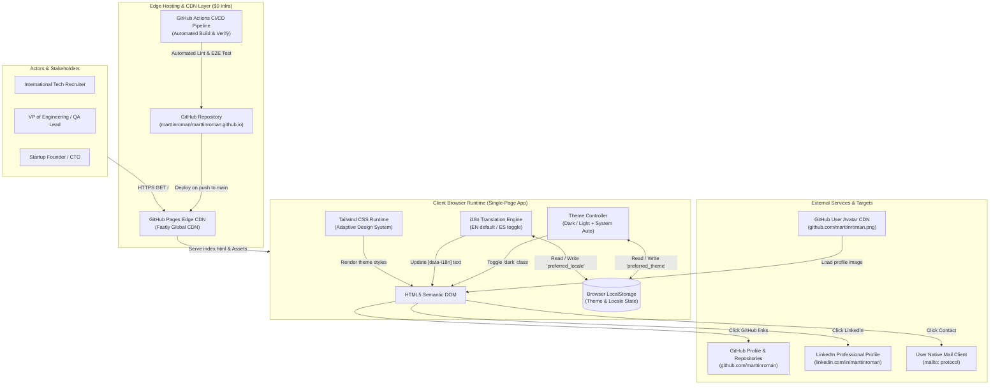
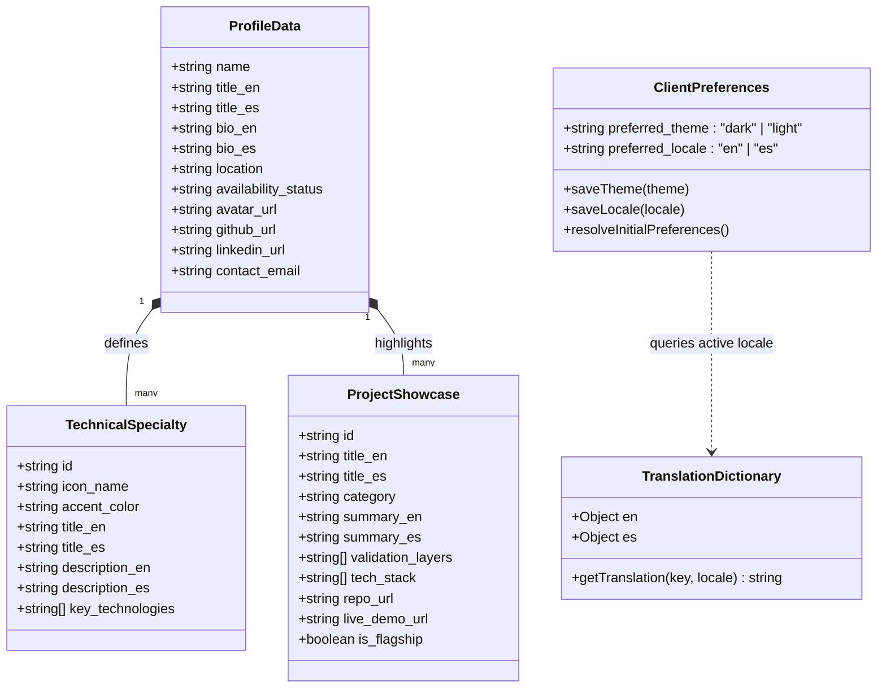
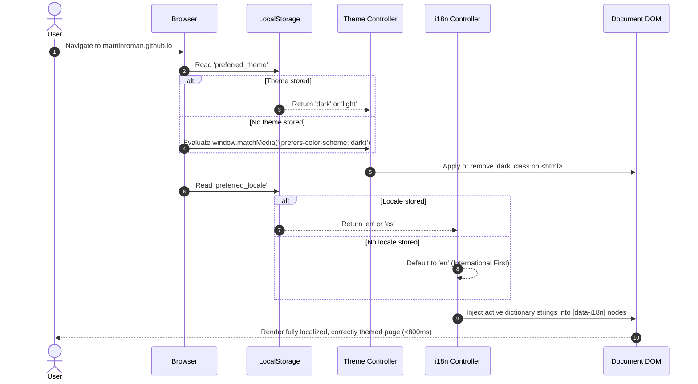
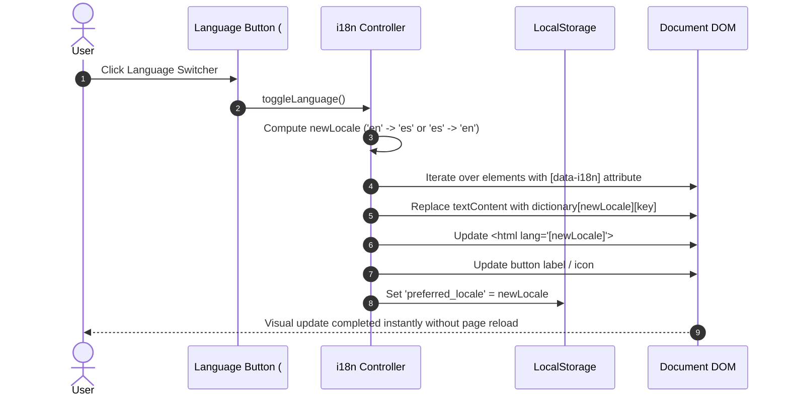

# SRS — Architecture Specifications

> **Document:** Software Requirements Specification (SRS) — Architecture Specifications  
> **Phase:** Fase 2 (Architecture)  
> **Project:** Marttin Roman Portfolio & Autonomous QA / AI-TestOps Showcase  
> **Target Platform:** GitHub Pages (`marttinroman.github.io`)  
> **Last Updated:** 2026-10-30  

---

## 1. System Architecture (C4 Level 1 & 2)

The system is designed under a **Zero-Cost, Static Edge Architecture**. The application delivers a high-speed, interactive client-side experience hosted on GitHub Pages with zero ongoing server maintenance or database costs.

---

## 2. Client-Side Data Architecture & Schemas

Because the portfolio is engineered for maximum performance and $0 infrastructure overhead, data persistence is maintained client-side via declarative models and browser storage:

---

## 3. Tech Stack Justification

| Technology Component | Selection | Justification (Pros) | Trade-offs & Mitigations |
| -------------------- | --------- | -------------------- | ------------------------ |
| **Hosting & CDN** | GitHub Pages | ✅ **$0/month infrastructure cost**. ✅ Automatic HTTPS/TLS 1.3 certificates. ✅ Global Fastly-backed CDN edge points. | ❌ Static-only (no server-side dynamic compute). *Mitigation:* Handled completely via client-side architecture and external services. |
| **Markup & Structure** | Semantic HTML5 | ✅ Universally accessible by web crawlers and screen readers. ✅ Sub-second browser rendering without framework hydration delay. | ❌ Manual markup synchronization. *Mitigation:* Modular section boundaries and declarative `data-i18n` attributes. |
| **Styling & Design System** | Tailwind CSS (CDN Runtime) | ✅ Rapid prototyping with utility classes. ✅ Built-in `class` based dark mode. ✅ Modern color palette (slate & sky) with glow blur effects. | ❌ Runtime CDN compilation file size (~100KB). *Mitigation:* Cached aggressively by browser; minified CSS build can be introduced in v2 if needed. |
| **Iconography** | Lucide Icons (CDN) | ✅ Clean, consistent SVG icon set matching modern developer tools. ✅ Lightweight client-side activation via `lucide.createIcons()`. | ❌ Requires CDN script download. *Mitigation:* Asynchronous script tag loading with zero rendering block. |
| **State & Localization** | Vanilla ES6+ Client Engine | ✅ Zero framework dependency bloat (no React/Vue runtime overhead). ✅ Instant locale and theme switching without page reloads. ✅ Seamless persistence in `localStorage`. | ❌ Manual state bindings. *Mitigation:* Clean, isolated controller functions (`setTheme`, `setLocale`) under 60 lines of code. |
| **CI/CD & Verification** | GitHub Actions & Playwright | ✅ Automated linting, code checks, and E2E regression tests on every push. ✅ Ephemeral cloud runners with free public minutes. | ❌ Public build minutes limit. *Mitigation:* Targeted workflows running under 2 minutes per execution. |

---

## 4. Key Data Flows

### A. Initial Load & Preferences Resolution Flow

### B. Interactive Language Switch Flow

---

## 5. Security Architecture

1. **Zero Server-Side Attack Surface:**
   - Hosted statically on GitHub Pages. No backend application servers, no server-side templating engines, and no SQL/NoSQL databases to compromise.
2. **Strict Client-Side Sanitization:**
   - Text updates during language switching exclusively use safe property setters (`textContent`), preventing Cross-Site Scripting (XSS) vectors.
3. **Outbound Hyperlink Security:**
   - All external anchor tags (`target="_blank"`) enforce `rel="noopener noreferrer"` to eliminate reverse tabnabbing and protect user referrers.
4. **Transport Layer Security:**
   - Enforced HTTPS / TLS 1.3 across all network transactions with HSTS headers enabled natively by GitHub Pages.
5. **Safe Storage Handling:**
   - `localStorage` operations are wrapped in defensive `try/catch` handlers to safeguard against private mode security exceptions (e.g., Safari Private Browsing sandbox restrictions).
