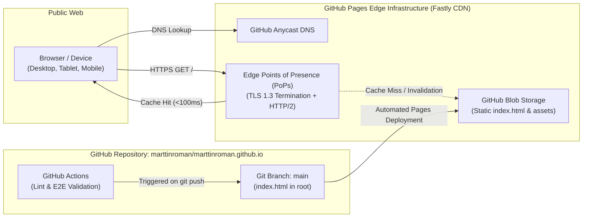
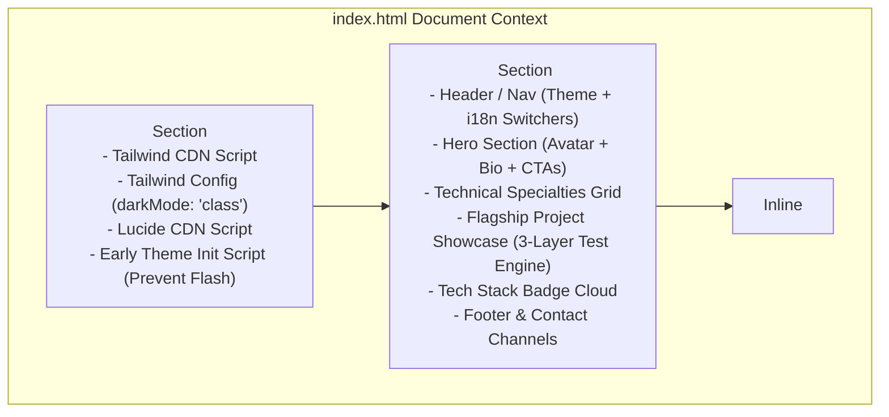

# SRS — Infrastructure Specification

> **Document:** Software Requirements Specification (SRS) — Infrastructure Specification  
> **Phase:** Fase 3 (Infrastructure)  
> **Project:** Marttin Roman Portfolio & Autonomous QA / AI-TestOps Showcase  
> **Target Platform:** GitHub Pages (`marttinroman.github.io`)  
> **Last Updated:** 2026-10-30  

---

## 1. Executive Summary & Cost Model

The infrastructure for `marttinroman.github.io` is designed under a **Zero-Cost, High-Performance Static Edge Architecture**. 

| Component | Provider / Technology | Monthly Cost | SLA / Performance |
| --------- | --------------------- | ------------ | ----------------- |
| **Edge Hosting & CDN** | GitHub Pages (Fastly Global CDN) | **$0.00** | 99.9% Uptime, TTFB < 150ms |
| **SSL / TLS Certificate** | Let's Encrypt via GitHub Pages | **$0.00** | Auto-renewing TLS 1.3 |
| **CI/CD Pipeline** | GitHub Actions (Ubuntu Runners) | **$0.00** (Free for public repos) | < 2 min execution time |
| **Version Control & Storage** | GitHub Git Repository | **$0.00** | Distributed Git |
| **DNS & Routing** | GitHub DNS (`*.github.io`) | **$0.00** | Optional custom domain ($12/yr) |
| **Total Recurring Cost** | | **$0.00 / month** | |

---

## 2. Network & Edge Deployment Architecture

---

## 3. Client Runtime Architecture

The application is completely self-contained within [index.html](file:///Users/marttinroman/projects/2026/portfolios/marttinroman.github.io/index.html), eliminating complex build steps, server hydration errors, and runtime dependencies:

### Module Responsibilities:
1. **Early Theme Initializer (in `<head>`):**
   - Reads `localStorage.getItem('theme')` or falls back to `window.matchMedia('(prefers-color-scheme: dark)')`.
   - Immediately adds or removes the `dark` class from `document.documentElement` before rendering, eliminating visual flicker (FOUC).
2. **I18n Translation Engine:**
   - Central dictionary containing English (default) and Spanish strings for all UI keys.
   - Reads `localStorage.getItem('lang')` or defaults to `'en'`.
   - Injects localized text into all elements with `data-i18n` attributes.
   - Injects localized `aria-label` attributes to maintain accessibility across languages.
3. **Theme Switcher Controller:**
   - Listens to user clicks on `#theme-toggle`.
   - Alternates between `dark` and `light` classes on `document.documentElement`.
   - Swaps Sun/Moon icons dynamically.
   - Persists selection to `localStorage`.
4. **Clipboard & Contact Helper:**
   - Provides seamless copying of `marttinroman@gmail.com` with a brief visual toast confirmation for users on devices without a configured mail client.

---

## 4. Custom Domain & Portability Strategy

To satisfy the constitution requirement of leaving open seamless migration to a custom domain (e.g., `marttinroman.dev` or `marttinroman.com`):
- **Relative Pathing:** All internal asset references and document navigation use relative paths (`./`) or hash anchors (`#`).
- **CNAME File Provisioning:** When a custom domain is ready, adding a single `CNAME` file at the root repository directory and configuring DNS records (`ANAME`/`ALIAS` to `marttinroman.github.io`) will route the site without code changes.

---

## 5. Automated CI/CD & Quality Gate Pipeline

A lightweight GitHub Actions workflow (`.github/workflows/ci.yml`) validates the site on every push:
1. **Linting & Code Integrity:** Runs `bun run lint` and Prettier format validation.
2. **HTML & Link Integrity Check:** Scans `index.html` for broken anchor tags, missing images, and invalid attributes.
3. **Automated E2E Verification:** Playwright headless test verifying:
   - Default English language loading.
   - Functional Spanish toggle without layout break.
   - Dark/Light mode class toggling.
   - Avatar fallback resilience.

---

## 6. Resilience & Disaster Recovery

- **Zero Database Degradation:** With no SQL or NoSQL database, there is zero risk of connection exhaustion, database corruption, or slow query latency.
- **CDN Edge Availability:** In the event of localized ISP disruptions, Fastly Anycast edge routing directs client requests to alternate healthy nodes.
- **Avatar Resilience:** If GitHub's user content CDN (`github.com/marttinroman.png`) is unreachable, client-side fallback immediately loads an SVG/initials avatar from UI-Avatars without throwing errors.
